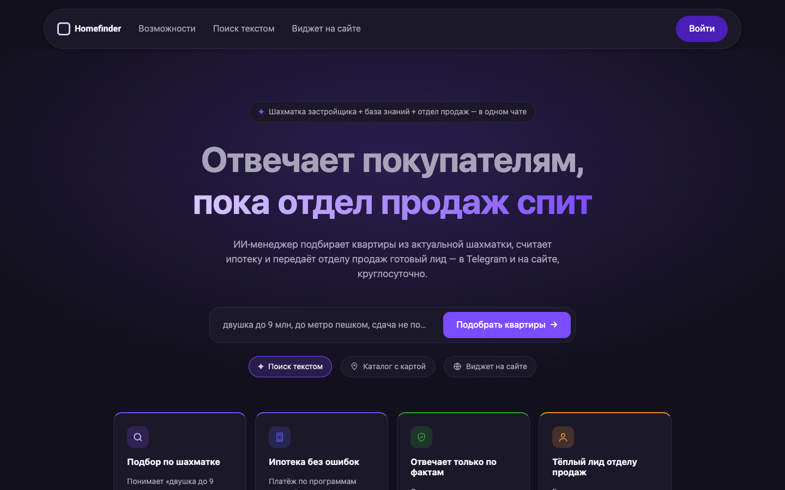
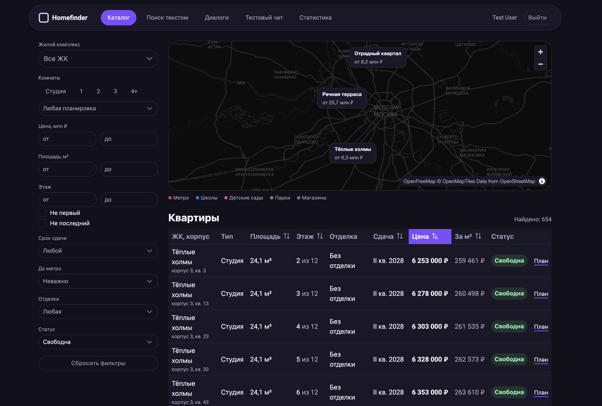
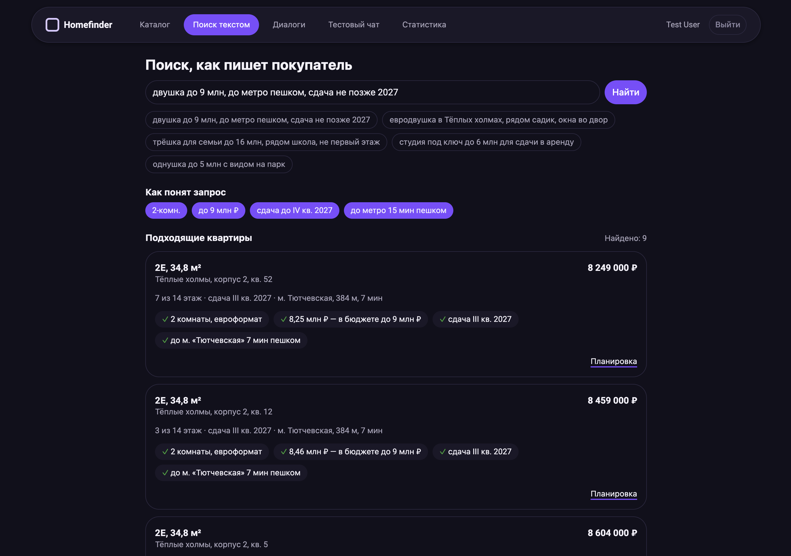
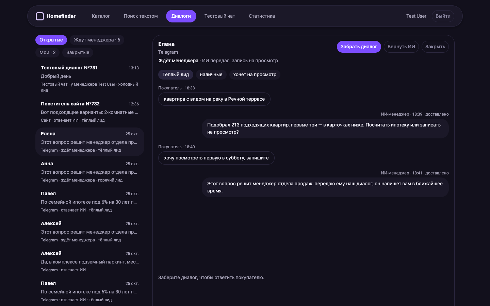
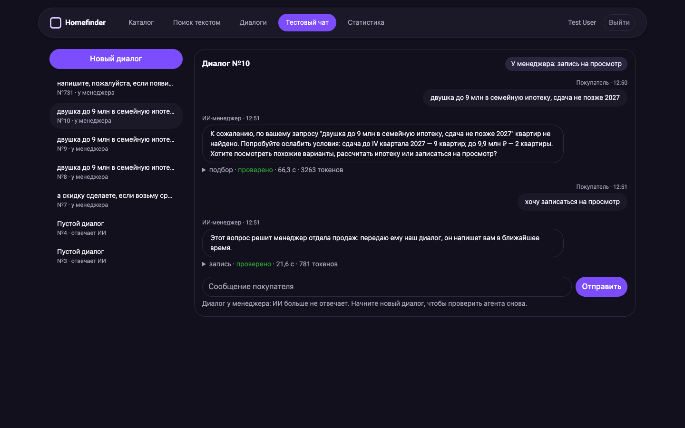
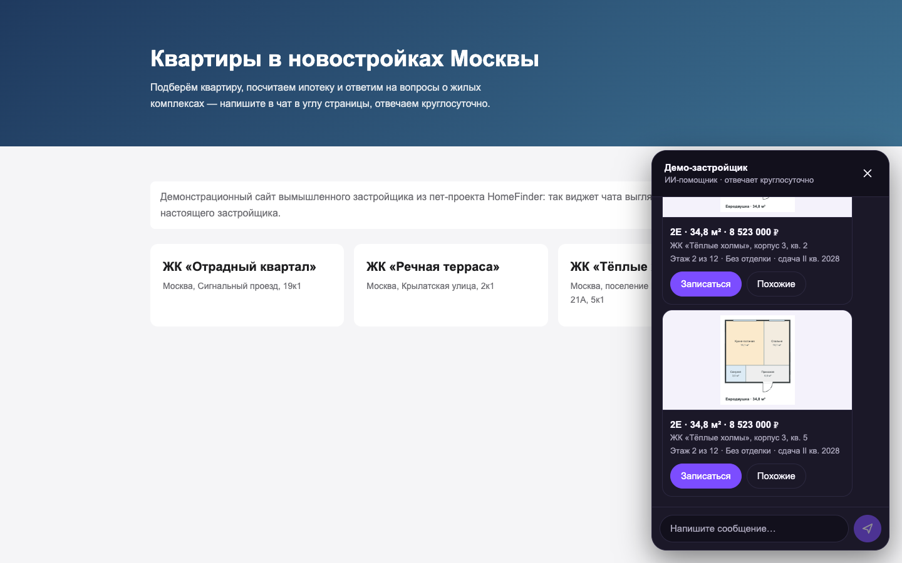
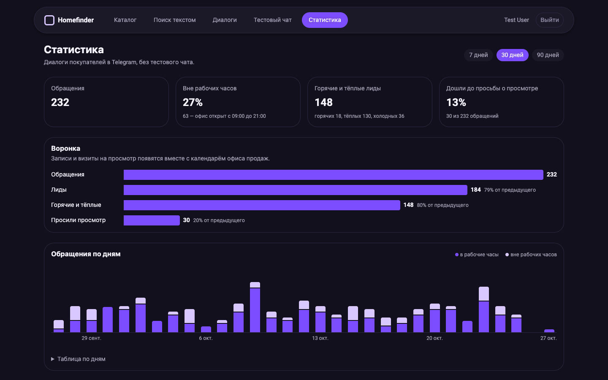
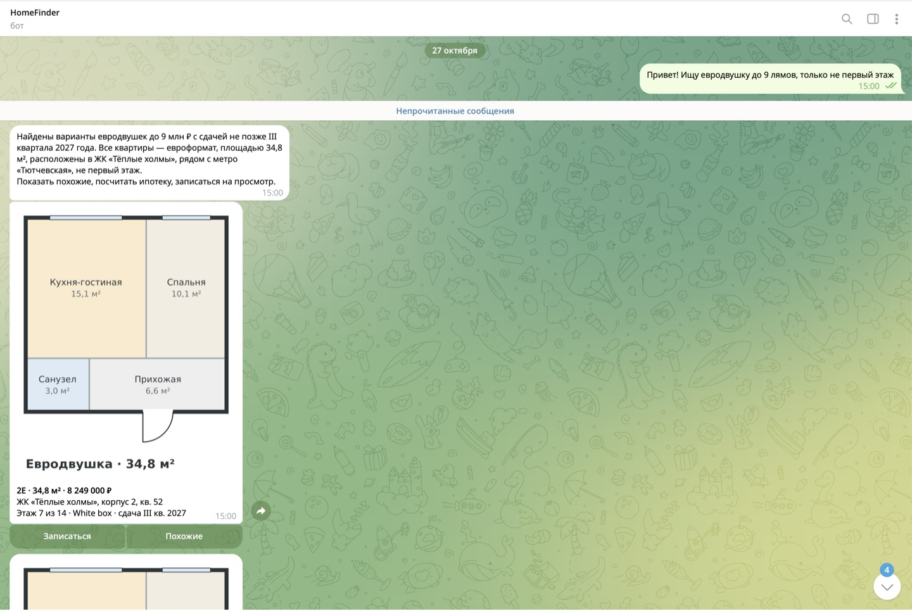
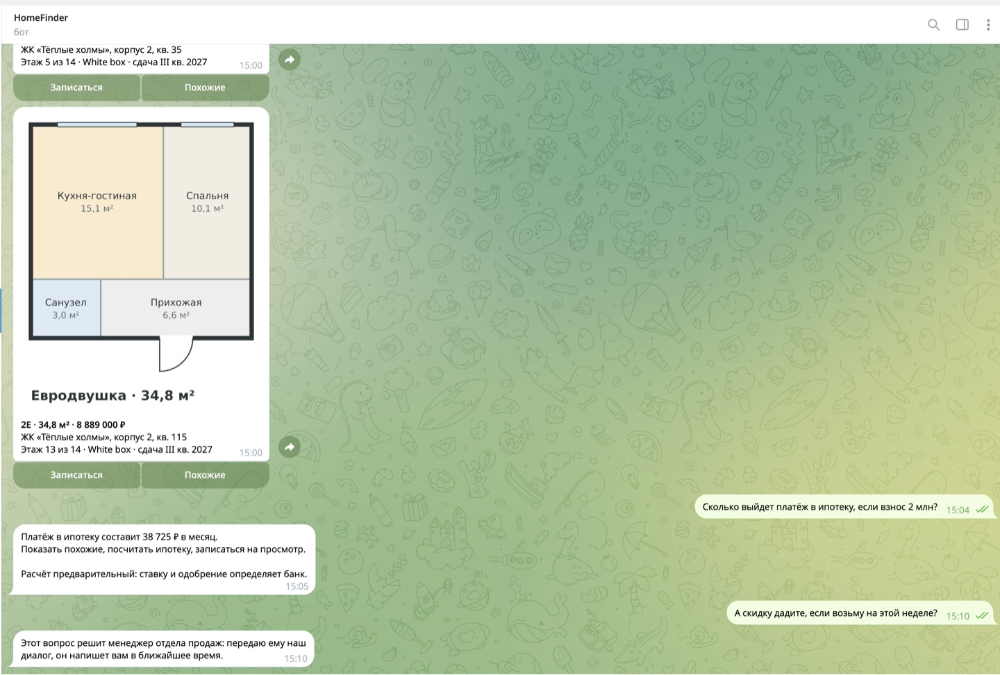

# Homefinder — ИИ-менеджер продаж для застройщика

ИИ-агент отвечает покупателям новостроек в Telegram и в чате на сайте круглосуточно:
- подбирает квартиры из актуальной шахматки;
- считает ипотеку;
- отвечает по базе знаний со ссылкой на источник;
- передаёт отделу продаж готовый лид.

**Главный принцип:** языковая модель понимает запрос и ведёт диалог, но цены, наличие и платежи берёт только из инструментов. Каждую цифру в ответе проверяет код.



Пет-проект для портфолио: Laravel + Vue (продукт) и Python + LangGraph (агент), локальные модели через Ollama. Данные — три вымышленных ЖК на реальных московских адресах, около 700 квартир в формате фида Яндекс Недвижимости.

## Стек

| Слой | Технологии |
| --- | --- |
| Продукт | PHP 8.3, Laravel 13, Horizon + Redis, Scheduler, Reverb |
| Фронтенд | Vue 3 + TypeScript, Inertia, PrimeVue, Tailwind 4, MapLibre + OpenFreeMap; виджет — отдельная сборка Vue |
| Агент | Python 3.12, FastAPI, LangGraph, Pydantic, LiteLLM, psycopg |
| Поиск | PostgreSQL 16 + PostGIS + pgvector + полнотекст; `bge-m3`, `bge-reranker-v2-m3` (llama.cpp) |
| Модели | `qwen3:8b` через Ollama, локально |
| Качество | Pest, pytest, ruff, mypy, vue-tsc; наборы оценки и симулятор покупателя; GitHub Actions |
| Инфраструктура | Docker Compose |

## Что умеет

| | |
| --- | --- |
| **Импорт** | фид Яндекса раз в час и шахматки CSV/XLSX; история цен и статусов; отчёт: добавлено, изменено, снято, ошибки строк |
| **Гео** | выгрузка OSM (osmium), Nominatim; метро в минутах пешком, школы, сады, парки, магазины в радиусе 1 км (PostGIS) |
| **Поиск** | self-query: «двушка до 9 лямов у метро» → фильтры в Pydantic-схеме → SQL; пожелания («светлая, вид на парк») — векторы `bge-m3`; `relax_filters`, если ничего нет |
| **База знаний** | гибридный RAG: полнотекст с русской морфологией + `bge-m3`, RRF → реранкер `bge-reranker-v2-m3` → corrective-шаг |
| **Агент** | граф LangGraph: намерение → инструменты (до 5 шагов) → ответ → **верификатор** |
| **Каналы** | Telegram-бот с карточками и планировками; виджет на сайт — один скрипт, custom element в shadow DOM |
| **Кабинет** | каталог с картой; поиск текстом, как пишет покупатель; общий чат всех диалогов в реальном времени с кнопкой «Забрать диалог»; карточки лидов; тестовый чат с журналом хода агента |
| **Подписки** | «Напишите, если появится двушка до 9 млн» — после импорта новые и подешевевшие квартиры уходят покупателю, не чаще раза в сутки |
| **Статистика** | воронка обращение → лид → просьба о просмотре; доля диалогов вне рабочих часов; что ищут, а квартир нет |

| | |
| --- | --- |
|  |  |
| Каталог с фильтрами и картой | Поиск текстом: фраза покупателя → фильтры и почему подходит каждая квартира |
|  |  |
| Общий чат: ИИ передал диалог, менеджер забирает | Тестовый чат: намерение, проверка, время и токены хода |
|  |  |
| Виджет на сайте застройщика | Статистика: воронка от обращения до просьбы о просмотре, доля обращений вне рабочих часов |
|  |  |
| Telegram: «евродвушка до 9 лямов, не первый этаж» → карточки с планировками | Платёж из `mortgage_calc` с пометкой кода; торг уходит менеджеру |

## Проверка качества

Качество ИИ не оценивали на глаз. У каждого уровня есть размеченный набор и целевая метрика, отчёты прогонов лежат в [`agent/evals/reports`](agent/evals/reports). Модель — локальная `qwen3:8b` на MacBook M2 16 ГБ; она меняется одной строкой в `.env`, а выбирается замером на одном наборе: `qwen3:8b` прошла 78% сценариев против 70% у `qwen2.5:7b`, запасных ответов 3 против 8.

| Уровень | Как проверяем | Результат | Цель |
| --- | --- | --- | --- |
| Код | Pest **475**, pytest **232**: граф агента — на сценарной модели с заранее заданными ответами | все проходят в CI | — |
| Разбор запроса | 204 фразы с размеченными фильтрами: «евродвушка», «до 9 лямов», «не первый этаж» | **97,0%** полей, 95,6% фраз целиком | ≥ 95% |
| База знаний | 115 вопросов, из них 18 без ответа в базе | **Recall@5 0,96**; на 18 из 18 — «уточню у менеджера», а не выдумка | ≥ 0,9 |
| Диалог целиком | симулятор покупателя: 31 персона, проверка кодом + LLM-судья по рубрике | **84%** в отчёте, 28 из 31 после исправлений | ≥ 85% |
| Передача менеджеру | торг, жалоба, юрист, трейд-ин, просьба человека | **100%** | ≥ 95% |
| Скорость | время хода в симуляторе | медиана 29 с, p90 67 с, ни одного дольше таймаута 120 с | — |

Модели и даты: фильтры и симулятор — `qwen3:8b`, 26–27.10.2026; база знаний — `qwen2.5:7b`, 22.10.2026.

### Верификатор: защита от выдуманных цифр

После генерации код сверяет ответ с результатами инструментов этого хода и ранее показанными квартирами:
- каждая цена, площадь, процент и номер квартиры в ответе есть в этих данных;
- квартира ещё в продаже;
- ежемесячный платёж взят из `mortgage_calc`.

Если ответ не прошёл проверку, модель переписывает его, видя список ошибок. Не помогло — покупатель получает «уточню у менеджера», а диалог уходит в отдел продаж. Пометку «расчёт предварительный» и ссылку на источник дописывает код, а не модель.

### Симулятор покупателя

Вторая LLM играет покупателя по сценарию:
- персона («самозанятый дизайнер, переживает за одобрение»);
- цель;
- поведение: пишет с опечатками, меняет бюджет, торгуется;
- факты, которые раскрывает по ходу: бюджет, взнос, состав семьи.

Каждый диалог проверяется дважды. Код смотрит запасные ответы, время хода, нужна ли была передача и вызваны ли нужные инструменты. Судья по рубрике оценивает, достигнута ли цель, отвечено ли по существу, не пообещано ли лишнее и какой тон. Сценарий засчитывается, когда согласны оба. Заодно меряется, насколько точно агент собрал карточку лида: 92% полей.

### Что нашли оценки

Ни одна из этих ошибок не была видна в юнит-тестах:
- **Дыра в верификаторе.** Процентом считалось любое число до 100 из данных инструментов. Оценка реранкера 0,1 «подтвердила» выдуманную «компенсацию 0,1% за месяц просрочки». Нашёл симулятор, теперь проценты берутся только из полей ставок, а случай закрыт тестом.
- **Потеря условий.** «А трёшки в Тёплых холмах?» после «до 10 млн» искал без бюджета, и агент называл квартиры за 15 млн «до 10 млн». Теперь новый запрос меняет только названные условия.
- **Выдуманные квартиры.** `qwen2.5` при пустом результате сочиняла квартиры: так появились 7 из 8 её запасных ответов. Верификатор не пропустил ни одной.
- **Обрезанный промпт.** Ollama молча обрезает промпт длиннее 4096 токенов: из 5400 токенов осталось 2050. Нашли на замерах. Если промпты агента вырастут до этого предела, нужно задать `num_ctx`.

### Ограничения

- Верификатор проверяет числа, а не утверждения. Выдумку без цифр («компенсирует проценты по вкладу») не ловит ни он, ни судья. Следующий шаг — сверять утверждения ответа с найденными фрагментами базы знаний.
- На 8B-модели просьба посчитать то, чего нет в инструментах (цену в рассрочку с наценкой), кончается запасным ответом. Выдуманное число до покупателя не доходит, но цель сценария не достигнута.
- 31 сценарий, а для уверенной оценки нужно 100–200. Набор растёт из провалов.

## Структура

Монорепозиторий: Laravel в корне, ИИ-сервис на Python — отдельный проект в `agent/` со своими зависимостями, тестами и Docker-образом. Сервисы общаются по HTTP с токеном.

```
homefinder/
├── app/                     Laravel: продукт
│   ├── Http/Controllers/    кабинет, вебхуки Telegram, API виджета
│   ├── Jobs/                ход агента, импорт фида, рассылка подписок
│   ├── Services/            Agent, Feeds, Geo, Knowledge, Search, Statistics…
│   └── Demo/                генераторы демо-фида и демо-диалогов
├── resources/js/            Vue + Inertia: кабинет и виджет (отдельная сборка)
├── database/ routes/ tests/
│
├── agent/                   Python: ИИ-сервис
│   ├── src/homefinder/
│   │   ├── api.py           FastAPI
│   │   ├── agent/           граф LangGraph, инструменты, верификатор, маскирование ПДн
│   │   ├── search/          self-query, фильтры, векторный поиск, ослабление фильтров
│   │   ├── knowledge.py     гибридный RAG и реранкер
│   │   ├── mortgage.py      ипотечный калькулятор
│   │   └── evals/           прогоны оценки и симулятор покупателя
│   ├── evals/               размеченные наборы и отчёты прогонов
│   └── tests/
│
├── docker/                  Dockerfile'ы php, agent, nginx, postgres
└── compose.yaml             app, horizon, scheduler, reverb, nginx, agent, reranker, postgres, redis
```

## Архитектура

Ключевые решения:
- **Агент ничего не пишет.** Сервис агента только читает базу. Передачу менеджеру, подписку и лид он возвращает как действия, а Laravel применяет их по своим правилам. Бизнес-правила живут в одном месте.
- **Мультитенантность.** У всех таблиц клиента есть `tenant_id` и глобальный скоуп. Застройщика определяет канал, а не текст покупателя и не ответ модели.
- **Персональные данные (152-ФЗ).** Телефоны и email заменяются плейсхолдерами до отправки в модель. Модели локальные. Согласие запрашивается в первом сообщении. Сообщения с одного контакта ограничены по частоте.
- **Деградация.** Без сервиса ИИ импорт и кабинет работают, а диалоги сразу уходят менеджерам. Ход агента идёт в очереди Horizon.
- **Перехват диалога.** Reverb рассылает только идентификаторы, страницы перечитывают данные через partial reload Inertia. Если менеджер забрал диалог во время хода агента, ответ агента отбрасывается: это проверяется под блокировкой строки.
- **Виджет.** Токен посетителя хранится в базе только хешем. У каждого посетителя свой приватный канал Reverb, cookies сайта не используются.

## Запуск

<details>
<summary>Нужны Docker, Node 22, <a href="https://docs.astral.sh/uv/">uv</a>, <a href="https://ollama.com">Ollama</a> и <code>llama-server</code> из llama.cpp</summary>

```bash
cp .env.example .env                      # если 5432 занят — DB_PORT; AGENT_TOKEN=$(openssl rand -hex 24)
docker compose build
docker compose run --rm app composer install
docker compose run --rm app php artisan key:generate
php artisan reverb:install                # ключи Reverb в .env
npm install && npm run build              # кабинет и виджет
docker compose up -d
docker compose exec app php artisan migrate --seed
```

Данные демо-застройщика:

```bash
docker compose exec app php artisan feeds:import 1                 # фид: ~700 квартир
docker compose exec app php artisan geo:import-pois                # окружение из OSM
docker compose exec app php artisan db:seed --class=DemoKnowledgeSeeder
docker compose exec app php artisan demo-dialogs:generate          # месяц истории для статистики
```

Модели:

```bash
ollama pull qwen3:8b && ollama pull bge-m3
llama-server -hf gpustack/bge-reranker-v2-m3-GGUF:Q8_0 --reranking --host 127.0.0.1 --port 8090 -c 2048
# на Linux вместо этого: docker compose --profile reranker up -d
cp agent/.env.example agent/.env          # AGENT_LLM_MODEL=ollama_chat/qwen3:8b, AGENT_LLM_REASONING_EFFORT=none
docker compose restart agent
docker compose exec app php artisan search:embed                   # векторы квартир и базы знаний
```

Каналы:

```bash
docker compose exec app php artisan widget:connect --tenant=1       # виджет; демо-сайт: /demo/site
docker compose exec app php artisan telegram:connect <токен> --tenant=1
docker compose exec app php artisan telegram:poll 1                 # локально; на сервере — telegram:webhook 1
```

`demo-feed:advance 7` сдвигает продажи на неделю: цены и статусы меняются, следующий `feeds:import 1` покажет изменения и разошлёт новости подписчикам.

</details>

Открыть <http://localhost:8080>, вход `test@example.com` / `password`.

## Разработка

```bash
php artisan test --compact                                  # Pest
vendor/bin/pint --dirty
cd agent && uv run pytest && uv run ruff check . && uv run mypy src tests

uv run python -m homefinder.evals.filters --save            # разбор запроса, ~5 мин
uv run python -m homefinder.evals.knowledge --save          # база знаний, нужен реранкер
uv run python -m homefinder.evals.simulator --only торг     # часть сценариев симулятора
uv run python -m homefinder.evals.simulator --save          # весь набор, 1,5–2 часа
```
